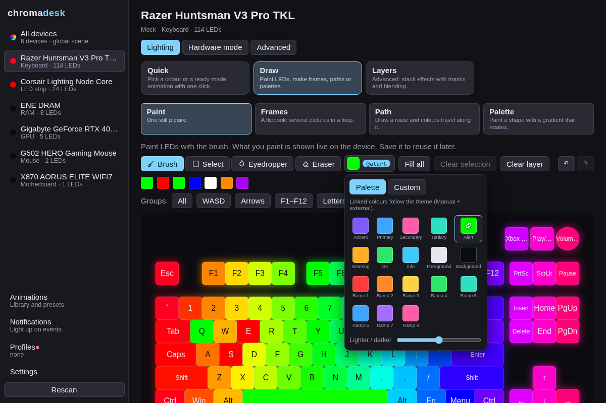
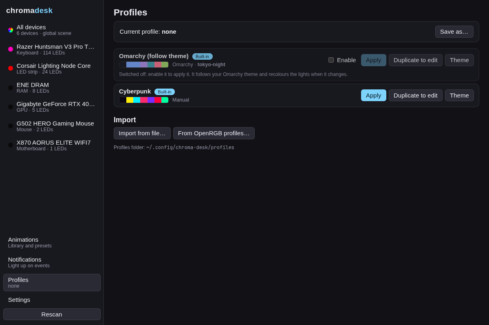
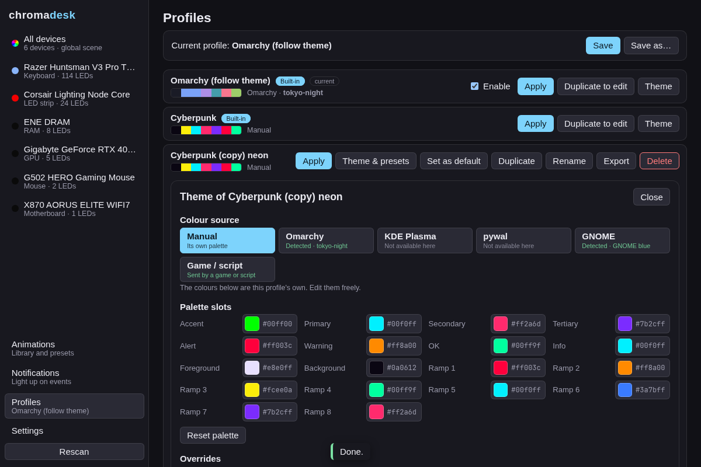
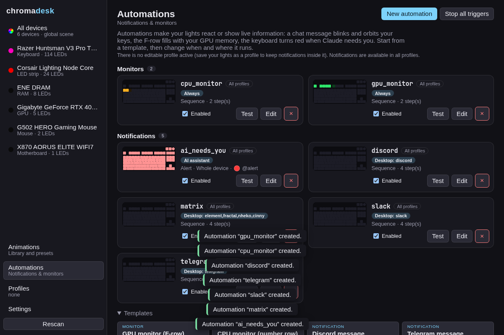
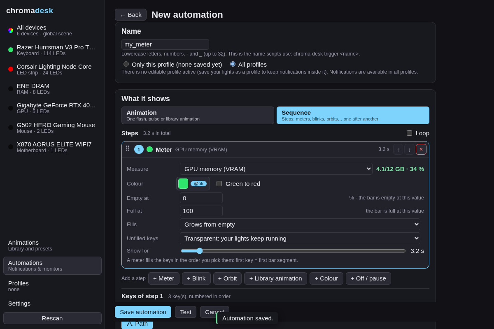
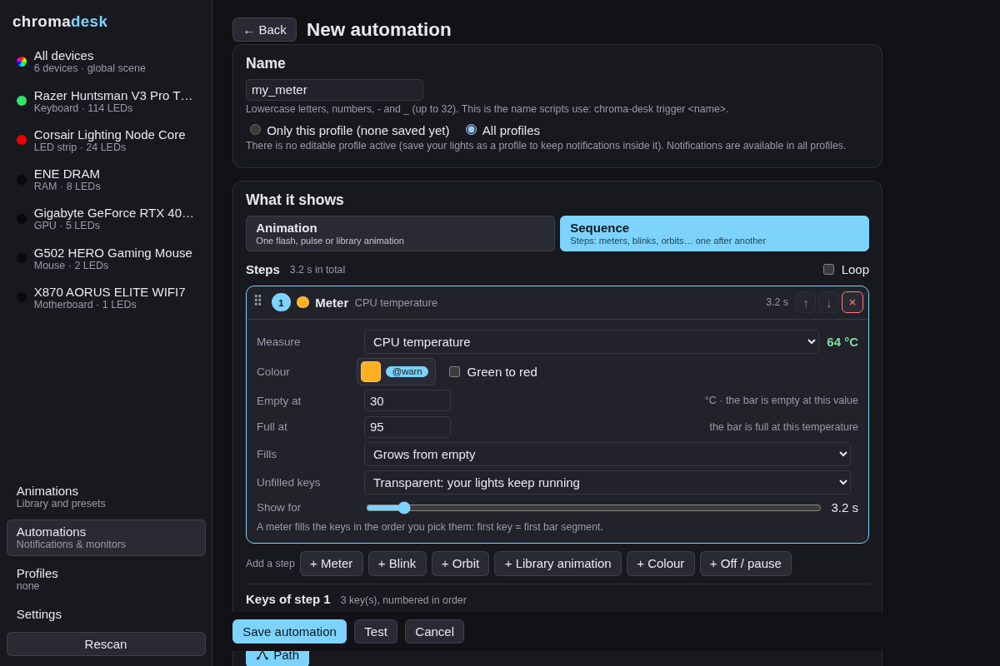
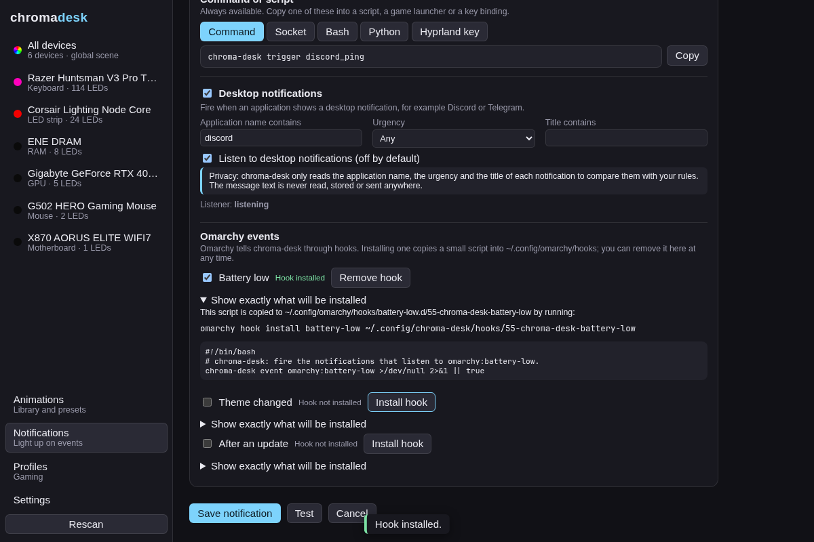

# chroma-desk

English · [Español](#español)

A modern desktop UI for [OpenRGB](https://openrgb.org) (Tauri 2 + Svelte 5 + Rust). It talks to the OpenRGB SDK server, so every device OpenRGB supports works.

## Features

- **Physical keyboard mock-up**: real key widths (ANSI/ISO, TKL/60 %/full), extras row (media keys, dial, logo), matrix fallback.
- **Paint any device LED by LED**: keyboards, matrices, strips, fan rings (pick a fan preset), single LEDs, multi-zone boards. Brush, rectangle selection, eyedropper, fill, eraser, quick groups (WASD, arrows, F-keys…), undo/redo (Ctrl+Z / Ctrl+Shift+Z).
- **Animations**: a library of reusable animations. Pick a ready-made preset (Rainbow, Breathing, Starlight, Wave, Chase, Alert, Heartbeat, Snake, Soft fire) with one click on the *Quick* tab, or draw your own in the *Draw* tab: **Frames** (a flipbook with timeline, onion skin, crossfade, loop/ping-pong/once), **Path** (drag over LEDs and a gradient travels along the route) and **Palette** (paint a shape with a gradient that rotates). Save them to the library, duplicate, rename, export and import `.json` files. Animations refer to LEDs by name (`Key: W`), so they also work on other keyboards (the UI shows how many LEDs match, e.g. `112/114 LEDs`).
- **Themes & palettes**: colours can be linked to the theme (`@accent`, `@alert`...); each profile follows Omarchy, KDE, pywal, GNOME, its own palette or a game. Built-in *Omarchy (follow theme)* and *Cyberpunk* profiles (see [Themes & games](#themes--games)).
- **Notifications**: a visual section to make the lights react to desktop notifications, Omarchy events (battery low...) or your own scripts (see [Notifications](#notifications)).
- **Triggers**: make the lights react to anything (see [Triggers](#triggers)).
- **Effect layers** with opacity, blend modes (normal/add/multiply/screen) and masks: Solid, Paint, Gradient, Breathing, Spectrum, Rainbow wave, Colour wave, Starlight, Strobe, Chase, Ripple.
- **Global synchronisation**: one effect runs across all your devices in the order you choose (keyboard → fans → RAM).
- **Hardware mode**: native OpenRGB modes (speed, brightness, direction, colours, save to device).
- **Profiles**: save, apply, duplicate, rename, delete, default profile, import/export `.json`, import OpenRGB profiles. Zone sizes (e.g. fans on a Corsair Lighting Node) are restored automatically.
- **Background**: tray icon (Show, Profiles, Lights off, Quit), close-to-tray, single instance, start on login, `--hidden`, `--apply-profile <name>`.
- English and Spanish UI (add a language by adding a JSON file in `src/lib/i18n/`).

Not included: effects that react to key presses.

## Install

### Arch Linux

```sh
cd packaging/arch && makepkg -si
```

Depends on `openrgb` (or `openrgb-razer`), `webkit2gtk-4.1` and `libayatana-appindicator`.

### From source

```sh
npm ci
npm run tauri build -- --no-bundle   # binary in src-tauri/target/release/chroma-desk
```

Development: `npm run tauri dev`. UI only, without hardware: `MOCK=1 npm run dev` (in-memory fake backend, open the printed URL in a browser).

## Command line

```sh
chroma-desk                       # open the window
chroma-desk --hidden              # start in the tray
chroma-desk --apply-profile Name  # apply a profile and exit if it only uses hardware modes;
                                  # profiles with effects keep running in the tray
chroma-desk profile Name          # switch profile in the running app
chroma-desk palette show|reload|clear|set <slot>=<#hex>...|source <id>
chroma-desk event omarchy:battery-low   # what Omarchy hooks run
```

If chroma-desk is already running, a second launch focuses it (or applies the profile there). `chroma-desk trigger ...` never opens a window: it talks to the running instance (see [Triggers](#triggers)).

## Triggers

A trigger plays an animation **over** your current lights for a few seconds (an overlay) and then your scene comes back. Use it for notifications: a script, a game mod, a cron job, a build finishing. Overlays stack, have a priority (higher is drawn on top), can be limited to some keys, and at most 32 can be active. Only devices in *Effects* mode take part (devices running a native hardware mode are left alone). chroma-desk must be running (in the tray is fine).

### Command line

```sh
chroma-desk trigger "Alert"                                   # the whole keyboard, 3 s
chroma-desk trigger "Alert" --keys W,A,S,D --duration 2s      # only WASD, 2 seconds
chroma-desk trigger "Heartbeat" --device razer --repeat 3     # 3 passes of the animation, only devices matching "razer"
chroma-desk trigger "Alert" --color '#00aaff' --priority 5    # recoloured, drawn over lower priorities
chroma-desk trigger --stop                                    # stop every active overlay
```

Options: `--device <key or part of the name>`, `--keys <W,A,S,D | "Left Shift" | idx:41>`, `--duration <3s | 500ms | 1.5 | 2m>`, `--repeat <N passes>`, `--color <#rrggbb | @slot>`, `--priority <-1000..1000>`. The animation is a name or id from the library (built-in presets included, e.g. `Alert`, `Heartbeat`). Exit code 0 on success, 1 if the app is not running or refused the request, 2 for a bad command line.

### Local socket (scripts, game mods)

chroma-desk listens on `$XDG_RUNTIME_DIR/chroma-desk.sock`, a Unix socket that only your user can open (mode 0600; nothing listens on the network). Send one JSON object per line, get one JSON line back:

```json
{"cmd": "trigger", "animation": "Alert", "keys": ["W", "A", "S", "D"], "duration": "2s", "color": "#ff0000", "repeat": 2, "priority": 5, "device": "razer"}
{"cmd": "stop"}
{"cmd": "list"}
{"cmd": "ping"}
```

`cmd` defaults to `trigger`. `duration` is a number of seconds or text such as `"500ms"`. Replies: `{"ok": true, "overlay": 3, "devices": 1, "duration": 2.0}` or `{"ok": false, "error": "anim_not_found", "detail": "Nope"}`. Lines are limited to 8 KiB, unknown fields are rejected.

**Bash**

```sh
SOCK="$XDG_RUNTIME_DIR/chroma-desk.sock"
echo '{"animation":"Alert","keys":["W","A","S","D"],"duration":"2s"}' | socat - UNIX-CONNECT:"$SOCK"
echo '{"cmd":"stop"}' | nc -U "$SOCK"          # OpenBSD netcat works too

# e.g. flash red when a long command finishes
make && chroma-desk trigger "Heartbeat" --color '#00ff66' --duration 2s || chroma-desk trigger "Alert" --duration 3s
```

**Python**

```python
import json, os, socket

def trigger(**spec):
    path = os.path.join(os.environ["XDG_RUNTIME_DIR"], "chroma-desk.sock")
    with socket.socket(socket.AF_UNIX) as s:
        s.settimeout(5)
        s.connect(path)
        s.sendall((json.dumps({"cmd": "trigger", **spec}) + "\n").encode())
        return json.loads(s.makefile().readline())

print(trigger(animation="Alert", keys=["W", "A", "S", "D"], duration="2s"))
```

The *Triggers* section of Settings shows these commands ready to copy, and every animation card has *Copy trigger command*.

## Themes & games

Every colour in chroma-desk is either **fixed** (`#ff0000`) or a **palette slot** (`@alert`). A slot is a name the active theme fills in, so the same layer, animation or notification looks different, and changes by itself, when the theme changes. The slots are the same in every theme: `background`, `foreground`, `accent`, `primary`, `secondary`, `tertiary`, `alert`, `warn`, `ok`, `info` and a ramp `c1`..`c8`. Old profiles and animations with plain colours load unchanged.



Every colour control (paint brush, animation editors, effect parameters, Quick, notifications) is the same **colour picker**: the *Palette* tab links the colour to a slot (a small `@accent` chip marks linked colours), the *Custom* tab sets a fixed colour.

### Where the colours come from

Each profile chooses a **theme source** (Profiles → *Theme & presets*):

| Source | Reads | Notes |
| --- | --- | --- |
| Manual | the profile's own palette | edit the 18 slots, or pin single slots with *overrides* (e.g. `alert` always pure red) |
| Omarchy | `~/.local/state/omarchy/current/theme/colors.toml` | follows `omarchy theme set <name>` within a second |
| KDE Plasma | `~/.config/kdeglobals` | read only |
| pywal | `~/.cache/wal/colors.json` | XFCE, i3, sway and others |
| GNOME | `gsettings` accent colour and light/dark scheme | basic |
| Game / script | colours sent over the socket | see below |

chroma-desk only **reads** these files. When a source is missing or malformed it keeps the last good palette and tells you. The current palette is shown in Settings → *Themes*, where you can also add rules such as "when the Omarchy theme becomes `catppuccin`, apply the profile Work" and (optionally) install a small Omarchy `theme-set` hook that pings the app after a switch (the app already watches the files; nothing is installed unless you press the button, and the exact command is shown).



### Built-in profiles

They ship inside the binary, are read-only and can be duplicated (*Duplicate to edit*):

- **Omarchy (follow theme)**: only offered when Omarchy is detected, **switched off until you enable it**. Keyboard: a lightened `@background` with a soft `@accent`→`@secondary` wave and WASD/arrows in `@accent`; fans: a `@primary` chase; RAM and GPU: `@accent` breathing. Notifications `notify`, `alert` and `success`.
- **Cyberpunk**: a neon palette (yellow accent, cyan, magenta, violet), a cyan→magenta scanline over a dark violet base, yellow WASD and an occasional **glitch**; chase on the fans, colour wave on the RAM. It comes with the *Neon Scan* and *Breach Alert* animations and the new `glitch` effect.



A profile can also **pin presets** (shown first in Quick while it is active). Profiles saved before this release get a Manual theme automatically.

### From a game or script

```sh
chroma-desk palette show                      # current palette
chroma-desk palette set accent=#ff0000 alert=#ff00aa   # layer colours on top of the theme
chroma-desk palette clear                     # drop them again
chroma-desk palette source omarchy            # switch the active theme source (until another profile is applied)
chroma-desk palette reload                    # re-read the source now
chroma-desk profile Cyberpunk                 # apply a profile by name
```

The same over the socket (`$XDG_RUNTIME_DIR/chroma-desk.sock`, one JSON line per request):

```json
{"cmd": "set_palette", "slots": {"accent": "#ff0000", "alert": [255, 0, 80]}}
{"cmd": "clear_palette"}
{"cmd": "palette"}
{"cmd": "palette_source", "source": "pywal"}
{"cmd": "set_profile", "name": "Cyberpunk"}
```

**Bash**

```sh
# a game launcher script: red alert theme while the game runs, back to normal afterwards
chroma-desk palette set alert=#ff0000 accent=#ff6600
game --fullscreen
chroma-desk palette clear
```

**Python** (a game or mod sending its own palette whenever the level changes)

```python
import json, os, socket

def send(**msg):
    path = os.path.join(os.environ["XDG_RUNTIME_DIR"], "chroma-desk.sock")
    with socket.socket(socket.AF_UNIX) as s:
        s.settimeout(5)
        s.connect(path)
        s.sendall((json.dumps(msg) + "\n").encode())
        return json.loads(s.makefile().readline())

send(cmd="set_palette", slots={"accent": "#00ff9f", "alert": "#ff003c", "background": "#0a0612"})
send(cmd="set_profile", name="Cyberpunk")
send(cmd="trigger", animation="low_health")        # a notification of the active profile
```

Colours sent by a script sit on top of the theme and of the profile's overrides; applying another profile drops them.

## Automations

An **automation** makes the lights react or show live information: a chat message blinks and orbits your keys, the F-row fills with your GPU memory, the keyboard turns red when an AI assistant needs you. Open *Automations* (subtitle *Notifications & monitors*) in the sidebar. Everything below also applies to plain notifications (flash on a message, red blink on low battery...); existing notifications keep working unchanged.



- **Cards** are grouped as *Monitors* (always on or on a threshold), *Timers* and *Notifications*, each with a live preview, a **When** chip ("Always", "Every 5 min for 10 s", "CPU temperature > 80 °C", "Desktop: discord", "AI assistant"), an *Enabled* switch and a **Test** button.
- **Templates** (read-only; adding one creates your own editable copy): *GPU monitor (F-row)*, *CPU monitor (number row)*, *Discord message*, *Telegram message*, *Slack message*, *Matrix message* (Element, Fractal, nheko, Cinny), *AI needs you* and the simple ones (*Flash all*, *Alert on WASD*, *Success pulse*, *Low battery*, *New desktop notification*, *Game: low health*).
- **Visual editor**: a single *Animation* (flash, pulse, blink, wave, fill or any library animation) or a **Sequence** of steps (*Meter*, *Blink*, *Orbit*, *Library animation*, *Colour*, *Off / pause*) that you add, reorder (drag or the arrows) and delete. Each step has its own colour (`@ok`, `@warn`, `@alert` follow the theme), timing and **keys picked in order on the keyboard drawing** (numbers show the order; quick sets for the F-row, number row, WASD and arrows). A live preview plays the whole sequence on the drawing.
- **Scope**: an automation belongs to the active profile (so it recolours with that theme) or is available in *all profiles*; a profile's own automation with the same name wins.



### System monitors

A **Meter** step draws a bar along the keys you picked, in that order, filled to the live value: `cpu.usage`, `cpu.temp`, `gpu.usage`, `gpu.vram`, `gpu.temp`, `ram.usage`. *Empty at* / *Full at* map the value to the bar (temperatures default to 30-95 °C), the last key is partly lit to show the exact fraction, and the editor shows the live reading next to the metric ("VRAM 2/12 GB · 17 %"). The bar is drawn **on top of the running scene**: unfilled keys are transparent, so the theme keeps animating underneath (optionally paint a dim or black track instead). The built-in templates fill Esc-F12 with VRAM (green) then GPU usage (white), and the number row with CPU usage (orange) then CPU temperature (red).

Sources: CPU usage from `/proc/stat`, CPU temperature from hwmon (`k10temp` Tctl, `zenpower`, `coretemp` Package), NVIDIA through NVML (loaded from the driver at run time; `nvidia-smi` as a fallback), AMD through sysfs (`gpu_busy_percent`, `mem_info_vram_*`), RAM from `/proc/meminfo`. *Settings → System monitor* shows what was detected, the GPU in use (automatic = the dedicated one) and live readings. **Sampling costs nothing when unused**: sensors are read twice a second only while a meter is being drawn, a threshold rule exists or the editor shows a live value, and everything is released a few seconds after the last one.

### When does it run?

Switch on one or more triggers in the editor:

| Trigger | What it does |
|---|---|
| **Always** | Plays in a loop on top of your lights while enabled (monitors). |
| **On a timer** | Every N seconds/minutes/hours, for D seconds. |
| **Command or script** | Always available (see below). |
| **Value crosses a limit** | A metric stays above/below a value for T seconds; *hysteresis* (it must retreat this far before it can fire again) and *cooldown* (minimum time between firings). |
| **Desktop notification** | Matches the application name (several apps separated by commas, e.g. `element, fractal`), urgency and title. |
| **Omarchy event** | battery low, theme changed, after an update. |
| **AI assistant** | `chroma-desk event ai:attention` (see *AI assistants*). |



### Command, desktop and Omarchy sources



1. **Command or script** (always on). The editor shows ready-to-copy snippets for *this* notification:

   ```sh
   chroma-desk trigger low_health                    # CLI
   chroma-desk trigger low_health --keys W,A --duration 2s --color '@alert'   # override on the fly
   echo '{"cmd":"trigger","animation":"low_health"}' | socat - UNIX-CONNECT:$XDG_RUNTIME_DIR/chroma-desk.sock
   ```

   ```lua
   -- Omarchy: ~/.config/hypr/bindings.lua
   o.bind("SUPER + ALT + N", "Notify: low_health", "chroma-desk trigger low_health")
   ```

   The name of a notification works anywhere an animation name does, and takes precedence: the profile decides what it looks like, so the same `chroma-desk trigger alert` looks different under *Cyberpunk* and *Omarchy*.

2. **Desktop notifications** (opt-in, off by default). chroma-desk watches the session D-Bus for `org.freedesktop.Notifications.Notify` calls and fires the notifications whose rule matches the **application name**, the **urgency** and/or text in the **title**, for example *app contains `discord`* flashes your chosen keys. Privacy: only the application name, the urgency and the title are compared; the message text is never read, stored or sent anywhere, and nothing is logged. Enable it with the *Listen to desktop notifications* switch in the editor.

3. **Omarchy events** (only shown when Omarchy is detected): *battery low* (`hooks/battery-low.d`), *theme changed* (`theme-set.d`) and *after an update* (`post-update.d`). Each has an **Install hook** button that shows exactly what will be installed: a tiny script copied with `omarchy hook install <type> <script>` into `~/.config/omarchy/hooks/<type>.d/55-chroma-desk-<type>`, which runs `chroma-desk event omarchy:<type>`. There is a **Remove hook** button too (it only deletes that one file). Hooks are never installed on their own.

   > **Requirement:** the hook scripts call `chroma-desk` from your `PATH` (falling back to `socat` and the socket). If neither is available the hook silently does nothing. Installing the package (`makepkg -si`, see *Install*) puts `chroma-desk` in `/usr/bin`. Check with `command -v chroma-desk || command -v socat`, and test a hook by hand with `chroma-desk event omarchy:battery-low` while the app is running.

```sh
chroma-desk event omarchy:battery-low    # what the hook runs; fires every enabled notification listening to it
```

### AI assistants

`chroma-desk event ai:attention [--from <tool>] [--kind permission|idle]` fires every enabled automation with the *AI assistant* trigger (optionally filtered by tool and kind); `chroma-desk event ai:clear` ends them early. The *AI needs you* template flashes the whole keyboard in the `@alert` colour for 10 s.

**Claude Code.** *Settings → AI assistants* (or the AI trigger in the editor) has **Set up Claude Code**: it shows the exact JSON, merges it into `~/.claude/settings.json` (all your other settings and hooks stay, in order), makes a backup copy first (`settings.json.chroma-desk-backup`), refuses to touch a file that is not valid JSON, and can remove the hook again. The hook it adds:

```json
{
  "hooks": {
    "Notification": [
      { "hooks": [ { "type": "command", "command": "chroma-desk event ai:attention --from claude" } ] }
    ]
  }
}
```

Claude Code fires `Notification` when it asks for permission or waits for your answer. **Other tools** (Codex CLI, aider, any script): run the same command from their notification/hook setting, e.g. `chroma-desk event ai:attention --from codex --kind idle`, or over the socket: `echo '{"cmd":"event","event":"ai:attention","from":"codex"}' | socat - UNIX-CONNECT:$XDG_RUNTIME_DIR/chroma-desk.sock`.

## Testing

```sh
cd src-tauri && cargo test && cargo clippy --all-targets -- -D warnings
npm run check && npm test
npm install --prefix e2e && npm run e2e   # real simulated mouse/keyboard against the MOCK=1 UI (needs Chromium)
```

## Start on login

Settings → *Start on login* creates `~/.config/autostart/chroma-desk.desktop` (runs `chroma-desk --hidden`). On Hyprland with uwsm, `systemd-xdg-autostart-generator` runs these entries; if yours does not, add `chroma-desk --hidden` to your compositor's autostart.

To keep the OpenRGB server alive, enable *Keep OpenRGB running with a systemd user service* in Settings (installs `chroma-desk-openrgb.service`, `openrgb --server --startminimized`). Close any OpenRGB you started by hand first.

## Troubleshooting

- **Omarchy events or `chroma-desk trigger` do nothing**: the app must be running (tray is fine) and `chroma-desk` must be on `PATH` — install the package with `makepkg -si`. `chroma-desk trigger …` exits with code 1 and says so when it cannot reach the app.

- **“Cannot reach OpenRGB”**: chroma-desk starts `openrgb --server --startminimized` if nothing listens on port 6742. Check that `openrgb` is installed and in `PATH`, or run it yourself with `--server`.
- **No devices / RAM or motherboard missing**: load the `i2c-dev` module (`echo i2c-dev | sudo tee /etc/modules-load.d/i2c.conf`) and install OpenRGB's udev rules (`60-openrgb.rules`), then re-login and press *Rescan*.
- **Two apps fighting over the lights**: the OpenRGB window and chroma-desk both write to devices; the last writer wins. chroma-desk warns when an OpenRGB window is open. Start OpenRGB with `--startminimized`.
- **Fan LEDs missing after reboot**: OpenRGB forgets zone sizes. chroma-desk re-applies the sizes you set in *Advanced*; make sure it starts on login or the default profile is set.
- **No tray icon**: you need a StatusNotifier host (Waybar `tray` module, KDE, GNOME extension). Without one, closing the window minimises it.

Config lives in `~/.config/chroma-desk/` (`config.json`, `profiles/*.json`, `animations/*.json`).

## License

GPL-2.0-or-later. Includes a patched copy of the `openrgb2` crate (GPL-2.0) in `src-tauri/vendor/`.

---

# Español

Una interfaz de escritorio moderna para [OpenRGB](https://openrgb.org) (Tauri 2 + Svelte 5 + Rust). Se comunica con el servidor SDK de OpenRGB, así que funciona con todos los dispositivos que OpenRGB soporte.

## Funciones

- **Maqueta física del teclado**: anchos reales de tecla (ANSI/ISO, TKL/60 %/completo), fila de extras (multimedia, dial, logo) y vista de matriz de respaldo.
- **Pintar cualquier dispositivo LED a LED**: teclados, matrices, tiras, anillos de ventilador (con preset), LEDs únicos y placas multizona. Pincel, selección por rectángulo, cuentagotas, relleno, borrador, grupos rápidos (WASD, flechas, F1–F12…) y deshacer/rehacer (Ctrl+Z / Ctrl+Shift+Z).
- **Animaciones**: una biblioteca de animaciones reutilizables. Elige un preset listo (Arcoíris, Respiración, Estrellas, Ola, Persecución, Alerta, Latido, Serpiente, Fuego suave) con un clic en la pestaña *Rápido*, o dibuja la tuya en *Dibujar*: **Fotogramas** (flipbook con línea de tiempo, papel cebolla, fundido y bucle/ida y vuelta/una vez), **Camino** (arrastra sobre los LEDs y un degradado viaja por la ruta) y **Paleta** (pinta una forma con un degradado que gira). Guárdalas en la biblioteca, duplícalas, renómbralas, expórtalas e impórtalas como `.json`. Las animaciones nombran los LEDs (`Key: W`), así que también funcionan en otros teclados (la interfaz muestra cuántos LEDs coinciden, p. ej. `112/114 LEDs`).
- **Temas y paletas**: los colores pueden enlazarse al tema (`@accent`, `@alert`...); cada perfil sigue Omarchy, KDE, pywal, GNOME, su propia paleta o un juego. Perfiles incluidos *Omarchy (follow theme)* y *Cyberpunk* (ver [Temas y juegos](#temas-y-juegos)).
- **Notificaciones**: una sección visual para que las luces reaccionen a notificaciones de escritorio, eventos de Omarchy (batería baja...) o tus scripts (ver [Notificaciones](#notificaciones)).
- **Disparadores**: haz que las luces reaccionen a lo que quieras (ver [Disparadores](#disparadores)).
- **Capas de efectos** con opacidad, modos de mezcla (normal/sumar/multiplicar/trama) y máscaras: Color sólido, Pintura, Degradado, Respiración, Espectro, Onda arcoíris, Onda de color, Estrellas, Estroboscopio, Persecución y Ondas.
- **Sincronización global**: un efecto recorre todos tus dispositivos en el orden que elijas (teclado → ventiladores → RAM).
- **Modo hardware**: modos nativos de OpenRGB (velocidad, brillo, dirección, colores, guardar en el dispositivo).
- **Perfiles**: guardar, aplicar, duplicar, renombrar, borrar, perfil predeterminado, importar/exportar `.json` e importar perfiles de OpenRGB. Los tamaños de zona (p. ej. ventiladores de un Corsair Lighting Node) se restauran solos.
- **Segundo plano**: icono de bandeja (Mostrar, Perfiles, Apagar todo, Salir), cerrar a la bandeja, instancia única, inicio con la sesión, `--hidden` y `--apply-profile <nombre>`.
- Interfaz en inglés y español (añadir un idioma = añadir un JSON en `src/lib/i18n/`).

No incluido: efectos reactivos a las teclas pulsadas.

## Instalación

### Arch Linux

```sh
cd packaging/arch && makepkg -si
```

Depende de `openrgb` (o `openrgb-razer`), `webkit2gtk-4.1` y `libayatana-appindicator`.

### Desde el código fuente

```sh
npm ci
npm run tauri build -- --no-bundle   # binario en src-tauri/target/release/chroma-desk
```

Desarrollo: `npm run tauri dev`. Solo la interfaz, sin hardware: `MOCK=1 npm run dev` (backend falso en memoria; abre la URL en un navegador).

## Línea de comandos

```sh
chroma-desk                       # abre la ventana
chroma-desk --hidden              # arranca en la bandeja
chroma-desk --apply-profile Nombre  # aplica un perfil y sale si solo usa modos hardware;
                                    # los perfiles con efectos siguen en la bandeja
```

Si chroma-desk ya está en marcha, un segundo lanzamiento lo enfoca (o aplica el perfil ahí). `chroma-desk trigger ...` nunca abre una ventana: habla con la instancia en marcha (ver [Disparadores](#disparadores)).

## Disparadores

Un disparador reproduce una animación **encima** de tus luces actuales durante unos segundos (una superposición) y luego vuelve tu escena. Úsalo para notificaciones: un script, un mod de juego, una tarea cron, un compilado que termina. Las superposiciones se apilan, tienen prioridad (la mayor se dibuja encima), pueden limitarse a algunas teclas y hay un máximo de 32 activas. Solo participan los dispositivos en modo *Efectos* (los que usan un modo nativo de hardware no se tocan). chroma-desk debe estar en marcha (en la bandeja basta).

### Línea de comandos

```sh
chroma-desk trigger "Alerta"                                  # todo el teclado, 3 s
chroma-desk trigger "Alerta" --keys W,A,S,D --duration 2s     # solo WASD, 2 segundos
chroma-desk trigger "Latido" --device razer --repeat 3        # 3 pasadas, solo dispositivos que coincidan con «razer»
chroma-desk trigger "Alerta" --color '#00aaff' --priority 5   # recoloreada, encima de prioridades menores
chroma-desk trigger --stop                                    # detiene todas las superposiciones
```

Opciones: `--device <clave o parte del nombre>`, `--keys <W,A,S,D | "Left Shift" | idx:41>`, `--duration <3s | 500ms | 1.5 | 2m>`, `--repeat <N pasadas>`, `--color <#rrggbb | @slot>`, `--priority <-1000..1000>`. La animación es un nombre o id de la biblioteca (incluidos los presets, p. ej. `Alert`, `Heartbeat`). Código de salida 0 si todo va bien, 1 si la app no está en marcha o rechazó la petición, 2 si la línea de comandos es incorrecta.

### Socket local (scripts, mods de juegos)

chroma-desk escucha en `$XDG_RUNTIME_DIR/chroma-desk.sock`, un socket Unix que solo tu usuario puede abrir (modo 0600; nada escucha en la red). Envía un objeto JSON por línea y recibes una línea JSON:

```json
{"cmd": "trigger", "animation": "Alert", "keys": ["W", "A", "S", "D"], "duration": "2s", "color": "#ff0000", "repeat": 2, "priority": 5, "device": "razer"}
{"cmd": "stop"}
{"cmd": "list"}
{"cmd": "ping"}
```

`cmd` es `trigger` por defecto. `duration` es un número de segundos o texto como `"500ms"`. Respuestas: `{"ok": true, "overlay": 3, "devices": 1, "duration": 2.0}` o `{"ok": false, "error": "anim_not_found", "detail": "Nope"}`. Las líneas se limitan a 8 KiB y los campos desconocidos se rechazan.

**Bash**

```sh
SOCK="$XDG_RUNTIME_DIR/chroma-desk.sock"
echo '{"animation":"Alert","keys":["W","A","S","D"],"duration":"2s"}' | socat - UNIX-CONNECT:"$SOCK"
echo '{"cmd":"stop"}' | nc -U "$SOCK"          # también sirve el netcat de OpenBSD

# p. ej. avisar cuando termina un comando largo
make && chroma-desk trigger "Heartbeat" --color '#00ff66' --duration 2s || chroma-desk trigger "Alert" --duration 3s
```

**Python**

```python
import json, os, socket

def trigger(**spec):
    path = os.path.join(os.environ["XDG_RUNTIME_DIR"], "chroma-desk.sock")
    with socket.socket(socket.AF_UNIX) as s:
        s.settimeout(5)
        s.connect(path)
        s.sendall((json.dumps({"cmd": "trigger", **spec}) + "\n").encode())
        return json.loads(s.makefile().readline())

print(trigger(animation="Alert", keys=["W", "A", "S", "D"], duration="2s"))
```

La sección *Disparadores* de Ajustes muestra estos comandos listos para copiar y cada tarjeta de animación tiene *Copiar comando de disparo*.

## Temas y juegos

Cada color de chroma-desk es **fijo** (`#ff0000`) o una **ranura de paleta** (`@alert`). Una ranura es un nombre que rellena el tema activo, así que la misma capa, animación o notificación se ve distinta, y cambia sola, cuando cambia el tema. Las ranuras son las mismas en todos los temas: `background`, `foreground`, `accent`, `primary`, `secondary`, `tertiary`, `alert`, `warn`, `ok`, `info` y una rampa `c1`..`c8`. Los perfiles y animaciones antiguos con colores simples se cargan sin cambios.

El **selector de color** es el mismo en toda la app (pincel, editores de animación, parámetros de efectos, Rápido, notificaciones): la pestaña *Paleta* enlaza el color a una ranura (un chip `@accent` marca los colores enlazados) y la pestaña *Personalizado* fija un color.

### De dónde salen los colores

Cada perfil elige un **origen del tema** (Perfiles → *Tema y presets*): Manual (paleta propia, con *colores fijados* para ranuras sueltas, p. ej. `alert` siempre rojo puro), Omarchy (`~/.local/state/omarchy/current/theme/colors.toml`, sigue a `omarchy theme set <nombre>` en menos de un segundo), KDE Plasma (`~/.config/kdeglobals`), pywal (`~/.cache/wal/colors.json`, para XFCE, i3, sway…), GNOME (acento de `gsettings`) o Juego/script (colores enviados por el socket). chroma-desk solo **lee** esos archivos; si uno falta o está mal formado mantiene la última paleta buena y avisa. La paleta actual se ve en Ajustes → *Temas*, donde también puedes añadir reglas («cuando el tema de Omarchy sea `catppuccin`, aplicar el perfil Trabajo») e instalar, si quieres, un pequeño hook `theme-set` de Omarchy (la app ya vigila los archivos; no se instala nada sin pulsar el botón y se muestra el comando exacto).

### Perfiles incluidos

Vienen en el binario, son de solo lectura y se pueden duplicar (*Duplicar para editar*):

- **Omarchy (follow theme)**: solo se ofrece si se detecta Omarchy y **viene desactivado** hasta que lo actives. Teclado: `@background` aclarado con una ola suave `@accent`→`@secondary` y WASD/flechas en `@accent`; ventiladores: chase `@primary`; RAM y GPU: respiración `@accent`. Notificaciones `notify`, `alert` y `success`.
- **Cyberpunk**: paleta neón (acento amarillo, cian, magenta, violeta), *scanline* cian→magenta sobre una base violeta oscura, WASD amarillo y un **glitch** ocasional; chase en los ventiladores y ola de color en la RAM. Trae las animaciones *Neon Scan* y *Breach Alert* y el nuevo efecto `glitch`.

Un perfil también puede **fijar presets** (salen primero en Rápido mientras está activo).

### Desde un juego o script

```sh
chroma-desk palette show                      # paleta actual
chroma-desk palette set accent=#ff0000 alert=#ff00aa   # colores encima del tema
chroma-desk palette clear                     # quitarlos
chroma-desk palette source omarchy            # cambia el origen del tema (hasta aplicar otro perfil)
chroma-desk palette reload                    # releer el origen ya
chroma-desk profile Cyberpunk                 # aplica un perfil por nombre
```

Lo mismo por el socket (`$XDG_RUNTIME_DIR/chroma-desk.sock`, una línea JSON por petición):

```json
{"cmd": "set_palette", "slots": {"accent": "#ff0000", "alert": [255, 0, 80]}}
{"cmd": "clear_palette"}
{"cmd": "palette"}
{"cmd": "palette_source", "source": "pywal"}
{"cmd": "set_profile", "name": "Cyberpunk"}
```

**Bash**

```sh
# script de lanzamiento: tema de alerta roja mientras dura el juego
chroma-desk palette set alert=#ff0000 accent=#ff6600
juego --fullscreen
chroma-desk palette clear
```

**Python** (un juego o mod que envía su paleta al cambiar de nivel)

```python
import json, os, socket

def send(**msg):
    path = os.path.join(os.environ["XDG_RUNTIME_DIR"], "chroma-desk.sock")
    with socket.socket(socket.AF_UNIX) as s:
        s.settimeout(5)
        s.connect(path)
        s.sendall((json.dumps(msg) + "\n").encode())
        return json.loads(s.makefile().readline())

send(cmd="set_palette", slots={"accent": "#00ff9f", "alert": "#ff003c", "background": "#0a0612"})
send(cmd="set_profile", name="Cyberpunk")
send(cmd="trigger", animation="low_health")        # una notificación del perfil activo
```

Los colores enviados por un script van encima del tema y de los colores fijados del perfil; al aplicar otro perfil se descartan.

## Automatizaciones

Una **automatización** hace que las luces reaccionen o muestren información en vivo: un mensaje de chat parpadea y recorre tus teclas, la fila F se llena con la memoria de la GPU, el teclado se pone rojo cuando una IA te necesita. Está en *Automatizaciones* (subtítulo *Notificaciones y monitores*) en la barra lateral. Lo siguiente también vale para notificaciones simples; las que ya tenías siguen funcionando igual.

- **Tarjetas** agrupadas en *Monitores*, *Temporizadores* y *Notificaciones*, con vista previa, un chip **Cuándo** («Siempre», «Cada 5 min durante 10 s», «Temperatura de CPU > 80 °C», «Escritorio: discord», «Asistente de IA»), un interruptor *Activada* y un botón **Probar**.
- **Plantillas** (de solo lectura; al añadir una se crea tu copia editable): *Monitor de GPU (fila F)*, *Monitor de CPU (fila de números)*, mensajes de *Discord*, *Telegram*, *Slack* y *Matrix* (Element, Fractal, nheko, Cinny), *La IA te necesita* y las simples.
- **Editor visual**: una *Animación* o una **Secuencia** de pasos (*Medidor*, *Parpadeo*, *Órbita*, *Animación de la biblioteca*, *Color*, *Apagado / pausa*) que añades, reordenas (arrastrando o con las flechas) y borras. Cada paso tiene su color, tiempos y **teclas elegidas en orden sobre el teclado** (con números). Una vista previa reproduce toda la secuencia.

### Monitores del sistema

Un paso **Medidor** dibuja una barra sobre las teclas que elijas, en ese orden, llena hasta el valor en vivo: `cpu.usage`, `cpu.temp`, `gpu.usage`, `gpu.vram`, `gpu.temp`, `ram.usage`. La barra se dibuja **encima de la escena activa**: las teclas sin llenar son transparentes y el tema sigue animándose debajo; la última tecla se enciende en proporción. *Ajustes → Monitor del sistema* muestra lo detectado, la GPU en uso y lecturas en vivo. **Muestrear no cuesta nada si no se usa**: los sensores se leen dos veces por segundo solo mientras hay un medidor dibujándose, una regla de umbral o el editor mostrando un valor.

### ¿Cuándo se ejecuta?

*Siempre* (en bucle sobre tus luces), *con temporizador* (cada N s/min/h durante D s), *comando o script*, *umbral* (una medida por encima/debajo de un valor durante T s, con histéresis y tiempo de espera), *notificación de escritorio* (varias apps separadas por comas), *evento de Omarchy* y *asistente de IA*.

### Asistentes de IA

`chroma-desk event ai:attention [--from <herramienta>] [--kind permission|idle]` dispara las automatizaciones con el disparador *Asistente de IA*; `chroma-desk event ai:clear` las termina antes. En *Ajustes → Asistentes de IA* el botón **Configurar Claude Code** muestra el JSON exacto, lo fusiona en `~/.claude/settings.json` (sin tocar nada más), hace antes una copia de seguridad y puede quitarlo. El hook es el mismo JSON de arriba (`Notification` → `chroma-desk event ai:attention --from claude`). Para otras herramientas (Codex CLI, aider, scripts) ejecuta ese mismo comando desde su configuración de notificaciones o hooks.

### Otros orígenes


1. **Comando o script** (siempre): el editor muestra fragmentos listos para copiar de *esa* notificación (`chroma-desk trigger low_health`, línea del socket, Bash, Python y un atajo de Hyprland `o.bind(...)` para Omarchy).
2. **Notificaciones de escritorio** (opcional, desactivado por defecto): chroma-desk observa en el D-Bus de sesión las llamadas `org.freedesktop.Notifications.Notify` y dispara las notificaciones cuyo criterio coincida con el **nombre de la aplicación**, la **urgencia** o texto del **título** (p. ej. *la app contiene `discord`*). Privacidad: solo se comparan el nombre de la aplicación, la urgencia y el título; el texto del mensaje nunca se lee, guarda ni envía, y no se registra nada.
3. **Eventos de Omarchy** (solo si se detecta Omarchy): *batería baja* (`battery-low.d`), *tema cambiado* (`theme-set.d`) y *tras una actualización* (`post-update.d`). Cada uno tiene un botón **Instalar hook** que muestra exactamente qué se instalará (un script pequeño copiado con `omarchy hook install <tipo> <script>` en `~/.config/omarchy/hooks/<tipo>.d/55-chroma-desk-<tipo>`, que ejecuta `chroma-desk event omarchy:<tipo>`) y un botón **Quitar hook** (solo borra ese archivo). Nunca se instalan solos.

   > **Requisito:** los scripts de los hooks llaman a `chroma-desk` desde tu `PATH` (y, si no está, a `socat` con el socket). Si no hay ninguno de los dos, el hook no hace nada y no avisa. Instalar el paquete (`makepkg -si`, ver *Instalación*) deja `chroma-desk` en `/usr/bin`. Compruébalo con `command -v chroma-desk || command -v socat` y prueba un hook a mano con `chroma-desk event omarchy:battery-low` con la app abierta.

## Pruebas

```sh
cd src-tauri && cargo test && cargo clippy --all-targets -- -D warnings
npm run check && npm test
npm install --prefix e2e && npm run e2e   # ratón/teclado simulados contra la interfaz MOCK=1 (necesita Chromium)
```

## Iniciar con la sesión

Ajustes → *Iniciar al iniciar sesión* crea `~/.config/autostart/chroma-desk.desktop` (ejecuta `chroma-desk --hidden`). En Hyprland con uwsm, `systemd-xdg-autostart-generator` ejecuta esas entradas; si la tuya no, añade `chroma-desk --hidden` al autoarranque de tu compositor.

Para mantener vivo el servidor de OpenRGB, activa *Mantener OpenRGB en marcha con un servicio de usuario de systemd* en Ajustes (instala `chroma-desk-openrgb.service`, `openrgb --server --startminimized`). Cierra antes cualquier OpenRGB lanzado a mano.

## Solución de problemas

- **Los eventos de Omarchy o `chroma-desk trigger` no hacen nada**: la app tiene que estar abierta (en la bandeja vale) y `chroma-desk` tiene que estar en el `PATH`: instala el paquete con `makepkg -si`. Si no puede contactar con la app, `chroma-desk trigger …` sale con código 1 y lo indica.

- **«No se puede contactar con OpenRGB»**: chroma-desk lanza `openrgb --server --startminimized` si nada escucha en el puerto 6742. Comprueba que `openrgb` está instalado y en el `PATH`, o ejecútalo tú con `--server`.
- **Sin dispositivos / faltan RAM o placa**: carga el módulo `i2c-dev` (`echo i2c-dev | sudo tee /etc/modules-load.d/i2c.conf`), instala las reglas udev de OpenRGB (`60-openrgb.rules`), vuelve a iniciar sesión y pulsa *Re-detectar*.
- **Dos aplicaciones peleando por las luces**: la ventana de OpenRGB y chroma-desk escriben en los dispositivos; gana la última que escribe. chroma-desk avisa si hay una ventana de OpenRGB abierta. Inicia OpenRGB con `--startminimized`.
- **Faltan LEDs de ventiladores tras reiniciar**: OpenRGB olvida los tamaños de zona. chroma-desk reaplica los que fijaste en *Avanzado*; asegúrate de que arranca con la sesión o de tener un perfil predeterminado.
- **Sin icono de bandeja**: necesitas un host StatusNotifier (módulo `tray` de Waybar, KDE, extensión de GNOME). Sin él, cerrar la ventana la minimiza.

La configuración está en `~/.config/chroma-desk/` (`config.json`, `profiles/*.json`, `animations/*.json`).

## Licencia

GPL-2.0-or-later. Incluye una copia parcheada del crate `openrgb2` (GPL-2.0) en `src-tauri/vendor/`.
